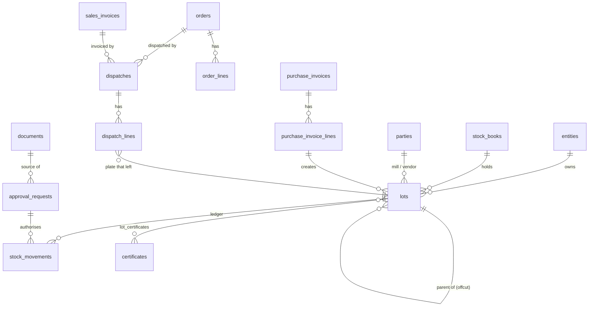

# Database schema v0 (applied 2026-10-10)

Supabase Postgres 17, project `oydcmbnpfyhqsdwmcyrm` · migrations in `supabase/migrations/` (file names = the versions recorded by Supabase; apply in order). Contains **no client data**.

**Status:** 10 migrations applied, 62 tables, RLS on all of them. A rollback-only test of 15 ledger rules passed (match key by mill, balance from movements, tolerance warn/block, append-only movements and audit log, locked lot facts, identity rules, packing-list rule, reversal, duplicate-document flag). Security advisor: one intentional warning (`decide_approval` is callable by signed-in users by design).

## Principles baked into the schema
| Principle (from the approved solution doc) | How it is enforced |
|---|---|
| Stock balance is calculated, never typed | `stock_movements` is the only source; `v_lot_balance`, `v_lots_current`, `v_stock_summary` derive the balance |
| Nothing is edited or deleted | Append-only triggers on `stock_movements`, `audit_log`, `lot_status_events`; core columns of `lots` are guarded; mistakes post a `reversal` movement |
| A person approves every important change | `approval_requests` inbox; decisions only through `decide_approval()` (role-checked, maker-checker, high-risk needs a reviewer note) |
| Every weight is kept | `lots`: invoice / theoretical / weighbridge; density and carrying cost are rows in `settings` |
| Traceability key follows the mill | `parties.match_key_type` (heat_no / plate_no); `lots.match_key` is set by trigger |
| Traceability survives cutting | `lots.parent_lot_id` (origin `offcut` / `coil_conversion`); a certificate is its own table and can cover many lots |
| No lot without identity | `lots_identity_chk`; mill purchases need a packing list, market purchases a plate number (trigger); legacy rows are flagged `legacy_missing`, never hidden |
| Entities and stock books never merge | `entity_id` and `stock_book_id` on every stock row; RLS scopes the partner role to books flagged `partner_visible` (WB2) |
| Failures are shown, never hidden | `exceptions` table; weight-tolerance warnings written by trigger |
| Rates, thresholds, templates are data | `settings`, `ref_values`, `whatsapp_templates` |
| Tally is read-only | `tally_*` tables are written only by the connector; nothing flows back |

## Migrations
| File | Contents |
|---|---|
| `…000100_foundation` | extensions, `app` helper functions, shared enums |
| `…000200_masters` | entities, stock books, yards, staff (+aliases), parties (+aliases, contacts), grades (+aliases), units, ref values, settings, import tracking |
| `…000300_documents_approvals_audit` | documents (duplicate detection), approval inbox, audit log, exceptions |
| `…000400_stock_ledger` | lots, costs, movements, status events, certificates, physical count, balance views, valuation function |
| `…000500_invoices` | purchase invoices and lines, sales invoices and workflow, paperwork tracker, brokerage |
| `…000600_orders_dispatch` | orders, lines, testing, CRM events, dispatches and dispatch lines |
| `…000700_mail_quotations` | mailboxes, threads, messages, client profiles, quotations, outcomes, follow-up views |
| `…000800_tally_gst_integrations` | Tally mirror, GST cross-check, Sheets backup log, WhatsApp |
| `…000900_rls_and_grants` | RLS on every table, grants, `decide_approval()` |
| `…093134_hardening` | counts-only mail summary without a definer view, fixed search paths, closed a built-in helper function, indexes on all foreign keys |

## Core relationships

## Assumptions that depend on the client's answers (isolated so they are cheap to change)
| Open item | Where it lives |
|---|---|
| Match key for Salzgitter, Acroni, market purchases | `parties.match_key_type` (data, not code) |
| Rule that assigns SPF vs Sai to a purchase / lot | `purchase_invoices.entity_id`, `lots.entity_id` are plain columns; the rule will be a function or app logic |
| Which certificate travels with a sale; when IBR applies | `cert_type` enum + `certificates` table; the rule is app logic |
| Density 7.85 vs 8.0, carrying cost 1.5%, tolerance 2% / 5% | `settings` rows, status `proposed` until HJ approves |
| How heat / plate numbers appear on Tally invoices | `tally_voucher_items.description` + `sales_invoice_lines.parsed_keys` |
| Whether `Material = 'purchase'` ever enters stock | assumed never (`order_lines.material_source`, no movement) |
| Plot "Other" | not seeded in `yards` until defined |
| Coil → plate conversion detail | `lot_origin = 'coil_conversion'` with a parent lot; refine after WB1 notes review |
| Expenses, GPay, budgeting | deliberately not in v0 (P2) |

## Not in v0 (next)
Seed data (grades and aliases, staff, parties), the import scripts that load WB2 then WB1 into `lots` / `stock_movements` with `legacy_refs`, a function to post a physical count, and Storage buckets/policies.
